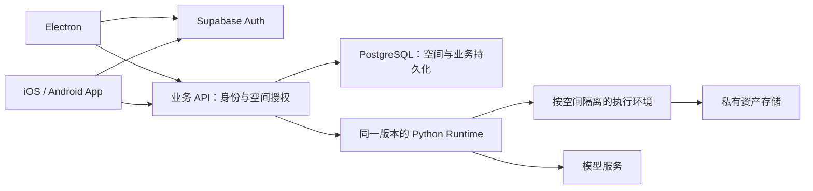

# 统一后端能力：实施方案与本次交付

更新：2026-11-16。本文区分已经运行验证的代码、仅完成源码的接入，以及后续实施项。它以用户最新确认的“本地联调，未来公共多用户服务”为目标；早期“每人必须连接自己的电脑”的产品假设不再是最终部署限制。

## 1. 最终产品结构

一个产品、同一套 Agent Runtime、两种客户端。Electron 和 App 通过业务 API 发起命令、读取状态、订阅事件。算法、上下文管理、工具语义、模型路由、任务与审批规则留在 Python Runtime。



图中 PostgreSQL 业务持久化、公共执行沙箱和资产 API 是目标架构；当前只完成账号/空间数据库和本地隔离目录 Runtime。当前进程以同一个操作系统用户运行，**目录隔离不是不可信代码的安全沙箱**。

### 复用与隔离的规则

| 内容 | 共用方式 | 隔离边界 |
|---|---|---|
| Engine、工具实现、协议、模型适配 | 所有人使用同一版本代码 | 不包含用户内容和密钥 |
| 模型目录与平台默认策略 | 可共用只读定义 | 每个空间的实际授权、额度和选择独立 |
| 会话、消息、草稿、审批、任务 | 同账号且有权限的设备可同步 | 不同空间默认不可访问 |
| 文件、Git、插件实例、MCP 配置 | 共用功能实现 | 独立文件系统、凭据、进程与网络策略 |
| 用户模型 Key、OAuth Token | 后端安全存储，按需注入 | 不进入客户端、其他空间或通用日志 |
| 主题、手势、布局、设备权限 | 客户端维护 | 可按设备不同 |
| 公开模板、公开技能 | 显式发布后共用 | 发布前排除用户私有内容与凭据 |

同一账号使用自己的手机和桌面同步数据是正常产品行为。不同账号的资源隔离由服务器实现，不能依赖客户端隐藏菜单或更换随机 ID。

## 2. 成熟组件的采用顺序

| 职责 | 采用路线 | 当前状态 |
|---|---|---|
| 身份、登录、会话刷新 | Supabase Auth + 官方 JS SDK | 本地真实服务已接入 |
| 数据库、迁移、行级权限 | Supabase PostgreSQL + CLI SQL migrations | 空间表和 RLS 已实现 |
| 附件和产物 | Supabase 私有 Storage | 待资产 API 实施；当前不启动 Storage |
| Agent 与模型行为 | 现有 Python Runtime / FastAPI | 直接复用原源码，无第二套 Engine |
| 生产文件/Shell/PTY/执行环境 | 优先验证 Daytona，E2B 备选 | 尚未选定或接入，需验证 Runtime 兼容性 |
| 多供应商模型网关 | 确有多供应商需求时接 LiteLLM | 当前不增加运行依赖 |
| 算法追踪与评测 | 开发阶段接 Langfuse | 未接入；先定义脱敏与评测数据集 |
| 故障观测、后台推送 | 公开预发布接 Sentry / OneSignal | 未接入；需要相应项目和平台配置 |
| API 类型与请求状态 | 稳定业务协议后生成 OpenAPI SDK，逐步采用 TanStack Query | 当前沿用已测试的请求层，未声称完成共享 SDK |

这些组件按职责逐步接入，不将所有服务变成本地启动前提。密码、令牌刷新、对象存储和容器调度不重新自研。算法路由、评测方法、状态一致性、资源授权和业务语义仍由项目负责。

官方依据：[Supabase 本地开发](https://supabase.com/docs/guides/local-development)、[Auth](https://supabase.com/docs/guides/auth)、[RLS](https://supabase.com/docs/guides/database/postgres/row-level-security)、[Storage 权限](https://supabase.com/docs/guides/storage/security/access-control)、[Daytona](https://www.daytona.io/docs/en/)、[E2B](https://docs.e2b.dev/)。详细选型沿用 [算法优先组件方案](algorithm-first-components-20261116.md)，不再部署旧方案中的第二套 Keycloak 身份系统。

## 3. 本次已经实现的链路

### 账号和授权

1. `scripts/dev-stack.mjs` 调用官方 Supabase CLI 启动精简本地栈，应用迁移，通过本地管理接口创建普通开发账号。
2. 每个新账号由数据库触发器创建唯一的个人空间；客户端没有直接创建、修改或枚举他人空间的权限。
3. App 使用官方 SDK 密码登录和会话刷新；浏览器不持久化会话，原生端使用系统安全存储。
4. `/v1/me` 返回已验证的用户及其可访问空间。
5. 每次 `/spaces/{workspace_id}/...` 请求先验证用户，再使用该用户身份经数据库 RLS 查询空间。不存在或无权限的空间统一返回 404。
6. 网关仅转发显式允许的业务路径，并替换为该 Runtime 的内部凭据。客户端不会获得管理凭据。
7. SSE 定期重新验证身份和空间归属；权限失效则结束事件连接。高频事件不会逐条请求身份服务。

涉及代码：`supabase/migrations/202611160001_personal_workspaces.sql`、`server/gateway.py`、`src/account-auth.ts`、`src/account-login.tsx`。

当前仅支持个人空间。团队成员角色、邀请、组织切换尚未实现；不能用现在的 owner 表结构冒充完整团队权限系统。

当前退出会清理本设备会话；不能据此声称所有已签发 access token 被立即作废。公共版本需要明确短期 token 有效期及服务端设备/会话撤销检查，再验收“撤销后 API 和 SSE 在规定时间内停止访问”。

### Runtime 归属

`server/runner.py` 直接导入原仓库的 Runtime 和 HTTP 路由。每个空间独立 HOME、DEEPSEEK_HOME、workspace、会话存储、随机内部令牌和进程；文件锁保证同一目录不能被两个 Runtime 同时持有。客户端不负责启动 Runtime。

本地网关只监听 `127.0.0.1`。**当前 Runner 强制使用离线 provider**，没有读取个人模型配置；模型 ID 切换用于验证配置和消息链路，不会产生付费调用。关闭网关会停止它拥有的子进程，数据目录保留。

这是本地验证环境，不允许直接改成 `0.0.0.0` 充当公共执行服务。公共环境必须完成沙箱、任务归属、配额、持久化与秘密管理。

### App 一致性修复

- 每次 HTTP/SSE 建连都获取当前 access token，不固定使用登录瞬间的 token；已创建客户端不能被另一个账号继续复用。
- 会话恢复键与审批偏好键包含账号/空间作用域；新登录及退出时清理内存草稿、附件状态、会话和待处理审批。
- 原生账号存储与旧设备配对存储分开，保留原配对记录。SDK 清理辅助键时不会误删主会话。
- 服务端快照更新模型/provider/mode；保留当前设备尚未提交的编辑，避免后台同步覆盖输入。
- 前台每 10 秒刷新会话目录，当前会话仍以 SSE + 快照同步。
- 导入的 `external_history` 历史正文按最终回答显示，修正“有内容但两端显示不一致”的一处原因。
- 账号模式不接受用户指定宿主机路径；未开放的项目、任务和扩展功能显示实际状态。
- 账号模式发送消息不再附带客户端旧的审批默认值，使用服务端保存的默认规则。

原后端同时增加了 `UpdateThreadRequest.auto_approve` 及持久化/事件通知。它修改未来回合的默认规则，不改变已经执行中的回合权限。

### 当前功能范围

账号环境已接入：登录、空间归属、会话列表/新建/重命名/分叉/归档/删除、消息与 SSE、停止/追加指令、模型选择、会话审批默认值、待审批/追问协议、Markdown 导出。审批/追问处理沿用原 Runtime；本次真实账号测试没有让离线 provider 生成工具调用来覆盖所有交互分支。

尚未接入账号环境：真实模型凭据配置、文件上传、Git/终端/浏览器/CUA、目标任务、后台任务、自动化、MCP/插件安装、编辑回退、生产用量与配额。这些能力在旧个人连接模式中的已有实现不等于已通过多用户隔离验收。

## 4. 本地使用

前提：Node 22+、Docker Desktop 或 OrbStack 已运行、原 Runtime 的 Python 环境已安装。

```sh
npm ci
npm run dev:stack
```

也可以双击项目根目录 `启动账号开发环境.command`。启动器不结束已有占用端口的服务，端口冲突时会报错。

- 预览：`http://127.0.0.1:5178/`。
- 开发账号：`.runtime/account/dev-account.json`，包含邮箱、随机密码和账号 ID；文件权限 0600，目录忽略提交。首次生成，重启复用。
- 网关配置：`.runtime/account/gateway.json`，只有公开 Auth key，无 service_role。
- 运行数据：`.runtime/account/spaces/<space-id>/`。
- 原仓库路径可用 `RUNTIME_SOURCE` 指定，Python 可用 `RUNTIME_PYTHON` 指定；不复制原 Engine 或个人数据。
- 停止预览时 Runtime 子进程退出；Supabase 数据库容器继续保留，可用官方 `supabase stop` 停止。不要使用会删除数据卷的清理命令。
- 原生打包必须配置实际可达的 Auth/API 地址；手机中的 `127.0.0.1` 指向手机自身。当前启动器验证电脑浏览器，不等于真机已可直连。

启动日志可能包含本地管理凭据，启动器将 CLI 输出写入权限 0600 的 `.runtime/account/` 日志，不打印这些凭据。不要分享该目录或将 service_role 填入 App。

## 5. 下一批实施：真正接通现有 Electron

**原 Electron 当前尚未接入新账号网关。两个浏览器的同步测试不等于 Electron 已完成。**

原桌面代码需要成组修改：

| 位置 | 具体修改 | 完成标准 |
|---|---|---|
| `packages/workbench/src/main/index.ts` | 区分 local-managed / account-remote；远端模式跳过 ensureRuntime 启动、端口回收、配置触发重启 | 桌面启动/退出不影响服务器或其他设备 |
| 主进程身份与 IPC | 用同一官方 Auth SDK；系统安全存储；只暴露登录状态与窄业务接口 | renderer 不拿管理 Key，无万能代理 |
| `runtimeRequest` 与 `runtime:sse:start` | 指向已授权空间；每次使用新 access token；共用 API 契约与事件解析 | 同一账号读到同一个 thread ID/turn ID/seq |
| renderer/chat store | 远端模式不要求本机模型 Key；模型目录和审批默认值来自服务器 | 桌面改设置后 App 自动同步，反向也成立 |
| 文件、终端、设置页 | 根据 capability manifest 展示空间资源；禁止将本机绝对路径发给公共服务 | 不会误操作用户电脑或服务器宿主目录 |
| 退出/切账号 | 取消 SSE、清空缓存和草稿、停止自动批准、解除通知绑定 | 后登录账号看不到前一账号的数据 |

共享 SDK 应从稳定的公共业务 OpenAPI 生成，并配合共用 SSE reducer/业务类型包；平台层只注入网络、系统安全存储和生命周期。先完成路径适配与契约测试，再逐步迁移现有请求缓存，不同时重写所有界面。

## 6. 公共服务的实施顺序与接口

### A. 统一协议与可靠写入

公共服务需提供标准能力清单，例如 `GET /v1/capabilities`：协议版本、可用功能、服务端限制、支持模型、所需客户端最低版本。当前 `/legacy/app` 仅保留精确的 capabilities 兼容调用，不应继续扩展成通用 IPC。

关键写操作接受 `client_request_id`。使用 PostgreSQL 唯一约束 `(workspace_id, command_type, client_request_id)`，同时保存请求哈希、目标 ID、受理状态和结果。相同 ID/相同请求返回原结果；相同 ID/不同内容返回 409。

“受理记录 + turn/job 预留 + outbox”在同一事务中提交；worker 用租约领取，Runtime 根据已预留 ID 继续执行。仅在网关缓存 HTTP 响应不足以保证幂等，因为进程可能在副作用发生后、保存响应前退出。工具本身还需要幂等键或结果对账；结果未知时不能自动再执行。

客户端写超时进入“状态待确认”，通过命令查询接口对账，不自动 POST 第二次。当前代码保持不自动重试写操作，**尚未实现上述持久化命令协议**。

### B. 空间执行与文件

使用选定的成熟沙箱服务托管空间文件系统和工具进程。镜像安装同一 Runtime 包，每个空间一个运行所有者；调度控制面记录 sandbox ID、Runtime 版本、租约和恢复状态。先验证长会话、暂停恢复、PTY、Git、浏览器、MCP 子进程、网络规则与持久卷，再确定供应商。

资产 API 使用 `asset_id`，服务端解析空间归属；上传先预留，完成后验证实际大小/类型/哈希，再进入消息。对象桶私有，下载使用短时签名 URL。挂载到沙箱的文件路径由服务器产生，客户端不能提供宿主机路径。

### C. 模型与算法

模型配置优先级：平台可用模型和硬限制 → 空间默认值 → 会话选择 → 本轮显式覆盖。请求必须验证模型是否可用，不能静默回退到更贵模型。密钥存放在服务端秘密管理设施，客户端只操作凭据引用和显示名称。

保留现有模型接口，先完成可配置真实 provider 的有界验证；多供应商接入时再验证 LiteLLM 的工具增量、多模态、推理参数、取消和用量兼容。离线评测和公司环境评测分开，不自动使用个人账户批量评测。

### D. 后台任务、审批与自动化

任务、审批、自动化均以服务端状态为准。服务器生成唯一任务/审批 ID；设备只提交明确决策。重复决策返回已确定结果或冲突。强制人工确认不会因另一设备的本地设置被绕过。

公共自动化只由服务端调度，设备关机不影响计划；带空间时区、预定触发时间和唯一执行键，先持久化计划再运行。移动后台消息通过推送提示重新同步，推送不是消息历史事实来源。

### E. 发布与升级

先对单空间验证，再双账号并发验证，最后灰度公共服务。新增字段保持向后兼容，删除/语义变化走版本升级；服务端用能力清单告知旧客户端不支持的功能。新 UI、原生权限与商店要求仍需发布客户端，不能承诺所有后端更新都自动让客户端获得新界面。

## 7. 验收要求

| 阶段 | 必须通过 |
|---|---|
| 本地账号闭环 | 登录、RLS、API 越权、空间进程隔离、模型/审批同步、事件回放、重启恢复 |
| Electron + App 对齐 | 原桌面与手机使用同一会话；任一端退出不停止 Runtime；不同账号双向隔离 |
| 可靠写入 | 丢响应/重复请求/进程崩溃/重启后均能对账，不重复创建任务或执行工具 |
| 文件与工具 | 越界路径、符号链接、跨空间资产、他人审批和输出订阅均被拒绝 |
| 公共运行 | 沙箱越界、配额、租约转移、备份恢复、数据删除、秘密轮换、日志脱敏 |
| 原生发布 | iOS/Android 编译、Keychain/Keystore、前后台恢复、断网、重新登录、可达 HTTPS、签名与商店验证 |

当前验证结果见后续“验证记录”。未通过的阶段不宣称完成上线。

## 8. 验证记录

- 前端单元测试：48 项通过。
- 前端 TypeScript 与生产构建：通过。
- 网关单元测试与原 Runtime 离线集成：6 项通过；覆盖跨空间拒绝、内部凭据、禁止宿主路径、请求体上限、模型/审批同步、SSE 回放、重启持久化。
- 原后端相关契约测试：8 项通过。
- 真实本地 Supabase 与网关联调：通过，执行 `node scripts/test-account-stack.mjs`；临时两账号的数据库 RLS 和 API 越权均验证，测试账号随后删除。
- 两独立浏览器会话 UI 同步：通过，执行 `node scripts/test-account-ui.mjs`；真实登录、聊天同步、模型/审批同步、退出清理均通过。截图位于 `artifacts/account/`；桌面尺寸浏览器不是原 Electron。
- iOS/Android：修改了安全存储源码，本机缺少完整 Xcode/Java，尚未编译或真机验证。
- 原 Electron 账号模式、公共沙箱、真实模型、生产幂等、后台推送：尚未完成。

本次没有移动/复制个人 `~/.deepseek` 数据，没有付费模型调用，没有创建云服务账号或公开部署。
